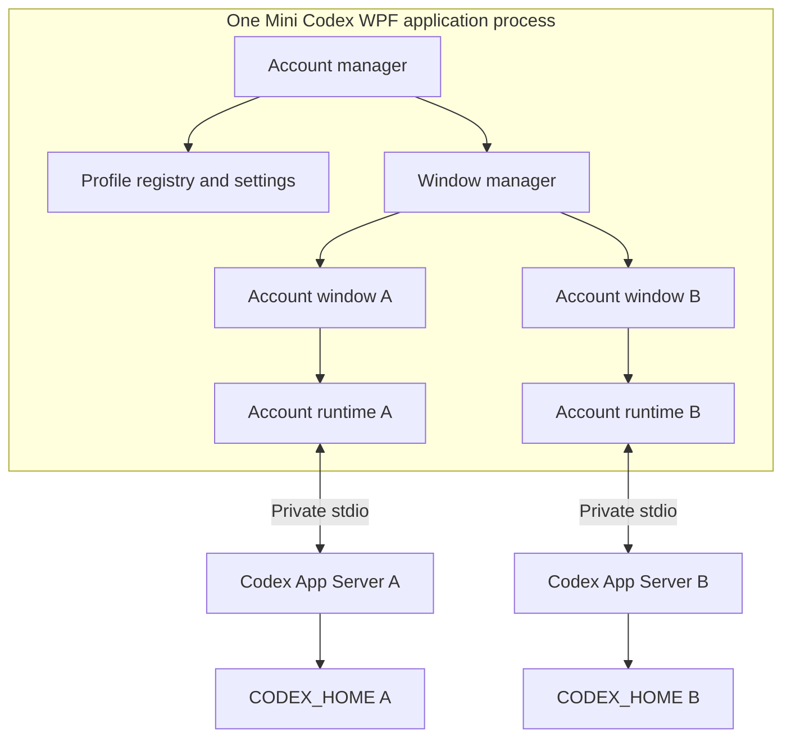

# Mini Codex architecture

Status: native UI, project folders, and the initial Codex App Server integration are implemented and build. Live authentication, task execution, and account-isolation acceptance remain unverified.

Decision date: 15 October 2026.

Phase 0 update: 16 October 2026. Prerequisites were inspected, a public CLI baseline was selected, and credential-storage policy was resolved. Runtime integration and account isolation have not been exercised.

Implementation update: 16 October 2026. After the UI delivery, the user authorized Codex integration and a rebuild. `src/MiniCodex/Codex` now owns the CLI launcher, JSONL transport, per-profile runtime, history, streamed items, approvals, and task interruption. Native account windows expose those operations. The official complete Windows x64 CLI 0.162.1 package is installed under `tools/codex/0.162.1`; its archive hash matches public release metadata. The connected Release build passes with 0 warnings and 0 errors. No live account sign-in or tool execution was performed by the assistant.

A subsequent update adds an explicit existing-home connection from the account manager, per-account sign-out there, hidden sign-in controls after authentication, independent window closing, and connection status at the bottom left. Existing homes keep their configured credential and SQLite settings; canonical duplicate homes and known shared state directories are rejected. Legacy item-pagination failures can use bounded turn-history pages. Those fixes were rebuilt with 0 warnings and 0 errors; live acceptance remains unverified by the assistant.

The latest source adds `SessionCatalog` and `SessionListItem` for a shared session list across every registered account and project. Summaries are keyed by profile and thread, with drafts keyed by profile and local chat. Opening a row routes to its owning profile and project; the selected project's folders only choose where new chats start. The catalog queries App Servers sequentially, pages each account independently, and retains partial results when an account fails. Runtime leases protect account windows and temporary list readers from disposing each other's connections. Closed-account servers are released after list refresh. No credentials or session stores are merged. These list/sidebar/theme changes have not been rebuilt or interactively verified.

Native Markdown formatting, Job Object cleanup after an application crash, subscription eviction in the server, and the acceptance gates below remain outstanding. Current message display is bounded selectable plain text. Source compilation does not establish credential isolation or protocol correctness at runtime.

Mini Codex is an independent, unofficial Windows client for the official Codex App Server. It provides multiple local account profiles, independent native windows, compatible local conversation history, and concurrent Codex work.

The implementation sequence and acceptance gates are in [IMPLEMENTATION_PLAN.md](IMPLEMENTATION_PLAN.md). This document records the agreed scope and the proposed design. Details explicitly marked as open remain subject to verification.

## Confirmed decisions

| Area | Decision |
|---|---|
| Platform and stack | Windows 11, C#, WPF, and .NET 10. Cross-platform UI support is not required. |
| Development baseline | .NET SDK 10.0.402 on Windows x64; Codex CLI 0.162.1 is the selected upstream stable integration target. |
| New-profile credential storage | Codex-managed `keyring`, without an application fallback to plaintext. Imported homes retain their effective storage policy. |
| Performance priority | Low total RAM with multiple account windows, including Codex and child processes. |
| Rendering | Native controls with basic Markdown, selectable code blocks, and copy buttons are sufficient for the MVP. |
| Imported Codex homes | Allow normal App Server writes. Mini Codex must not directly rewrite Codex credentials, transcripts, indexes, or database files. |
| Shared conversations | One client at a time per conversation. Concurrent use of the same conversation in Mini Codex and the official client is outside the supported workflow. |
| Closing a busy window | Ask whether to stop its active tasks before closing. Cancelling keeps the window and tasks open. |
| Implementation | Native UI, folder management, Codex integration, and a rebuild are authorized. Live account checks and performance measurements have not been run. |
| Project folders | Each project has multiple attached folders and one primary command directory. Every chat uses the project's current folder list. |

Carry forward the original requirements for dynamic profiles, one native window per profile, one App Server per active profile, supported authentication, existing-session compatibility, and explicit tool approvals. Do not introduce a fixed limit on stored profiles or promise unlimited simultaneous work on finite hardware.

Reliability, profile isolation, and session compatibility take precedence over memory savings. An active task must never be terminated merely to meet a memory target.

## Stack and dependencies

| Concern | Choice | Reason |
|---|---|---|
| Application | One WPF executable targeting `net10.0-windows`; pinned SDK 10.0.402 | Native Windows UI and a shared application lifetime. |
| Presentation | XAML views and per-window view models | Keep rendering and interaction separate from process and protocol logic. |
| Observable properties and commands | A small `INotifyPropertyChanged` base with view models and native event handlers | The initial UI needs no third-party packages or application framework. Revisit only if the command layer grows. |
| Processes and I/O | .NET process, stream, cancellation, and task APIs | No separate Node.js application service. |
| JSON and queues | `System.Text.Json` and `System.Threading.Channels` | Use platform libraries for messages, persistence, and bounded queues. |
| Settings | Versioned local JSON | No application database is needed for a profile registry and UI preferences. |
| Markdown | Native rendering of a defined subset; parser selection remains open | Avoid adding WebView2 solely for message rendering. |
| Codex | Official Windows x64 CLI 0.162.1; configured absolute path or project-local complete package | Keep inference, tools, authentication, and conversation persistence in Codex. Desktop/plugin alpha binaries are outside this baseline. |

React, MobX, Vite, SCSS, Tauri, and the Rust application backend are removed from the revised design. Codex itself remains an external process. Do not add a browser, terminal emulator, dependency-injection framework, or generic event bus without a concrete need.

WPF is a fit for the accepted requirements, not a proven memory winner. No Mini Codex RAM or startup measurements exist. See [WPF](https://learn.microsoft.com/en-us/dotnet/desktop/wpf/overview/), the [MVVM Toolkit](https://learn.microsoft.com/en-us/dotnet/communitytoolkit/mvvm/), and the [.NET support policy](https://dotnet.microsoft.com/en-us/platform/support/policy/dotnet-core).

## Domain language

| Term | Meaning |
|---|---|
| Profile | A local container identified by an immutable `ProfileId`, with a display name and one canonical `CODEX_HOME`. The UI may label it Account 1, Account 2, and so on. |
| Account identity | The ChatGPT identity currently authenticated in a profile. It may change after logout and login; it is not the profile's primary key. |
| Thread | A persisted Codex conversation identified by `ThreadId` within a profile. The UI may call it a chat or conversation. |
| Turn | One submitted user request and the agent work it produces, identified by `TurnId`. |
| Account runtime | The application's owner of one profile's App Server process, connection, pending requests, and live task state. |
| Account window | A native WPF window bound to one profile by trusted application code. |
| Project | A named group of attached folders and local chats, with one primary working directory. All its chats share its folder list. It is not a separate copy of Codex history. |

Do not use an email address, display name, window title, or directory basename as a profile identifier. Scope thread state by `(ProfileId, ThreadId)` and turn state by `(ProfileId, ThreadId, TurnId)`.

## Process and ownership model



The application lifetime owns the registry, window manager, and runtime registry. Each account runtime owns its process supervisor, protocol client, authentication summary, thread state, and approval requests. A window observes its runtime; it does not own the child process.

Start a runtime only when an account is opened or an explicit account operation requires it. Reuse it across chats. Serialize concurrent start attempts so opening the same profile twice cannot launch two servers. Focus the existing account window in the MVP.

Use explicit WPF shutdown handling. Closing one account window must not trigger application exit. Keep the account manager available; closing it is an application-exit request. Avoid a hidden tray lifetime in the MVP. A single-instance guard should route a second launch to the existing manager rather than create competing runtimes.

## Code organization

The following shows the intended integration layout. The current UI is implemented in `src/MiniCodex/Models`, `Services`, `Presentation`, `Views`, and `ViewModels`; the Codex integration folders below remain future work.

```text
codex-mini/
  docs/
    ARCHITECTURE.md
    IMPLEMENTATION_PLAN.md
  src/
    MiniCodex/
      MiniCodex.csproj
      App.xaml
      App.xaml.cs
      Accounts/          # Profile registry, identity summaries, runtime ownership
      Codex/
        Protocol/        # Version-specific wire contracts and envelope parsing
        Transport/       # Stdio connection, pending requests, notification dispatch
        Processes/       # Executable resolution and process supervision
        Sessions/        # Thread queries, live state, and history pages
      Windows/           # Window bindings, persistence, and close coordination
      Settings/          # App-owned JSON persistence and schema migration
      Views/
      ViewModels/
      Rendering/         # Native message blocks and Markdown subset
      Diagnostics/       # Redacted, bounded application diagnostics
  README.md              # Added later with real setup and usage instructions
```

Start with one application project and cohesive folders. Extract projects only if a verified dependency boundary requires it. Future test files, solution files, schemas, and packaging files are not created by this plan.

The current `AppController` commits a validated settings snapshot before publishing it to view models. Each local chat belongs to one project and resolves that project's current folder list through `WorkspaceForChat`; it does not keep a stale copy. The primary directory controls the future command working directory, while all project folders will form the intended access roots subject to the actual Codex sandbox. Folder selection alone does not grant permissions to an unconnected runtime.

Manage folders stages edits until Save. It uses the native multi-folder picker, resolves Windows directory aliases before duplicate checks, requires at least one folder and a primary folder from that list, and requires selecting a replacement before removing the primary folder. Removal only changes Mini Codex settings.

## Major interfaces and boundaries

| Component | Responsibility and contract |
|---|---|
| `ProfileRegistry` | Add, rename, link, and remove profiles; atomically persist the registry; enforce unique IDs and canonical homes. |
| `WindowManager` | Open or focus a profile window, bind it to its profile, restore bounds, and coordinate closing. |
| `AccountRuntimeRegistry` | Get or start one runtime per profile; coordinate shutdown and expose safe status summaries. |
| `CodexProcessSupervisor` | Resolve a trusted executable, construct a profile-specific environment, start and reap the process, and report exit. |
| `CodexRpcClient` | Frame messages, correlate requests, dispatch notifications and server requests, enforce limits, and invalidate a lost connection. |
| `AccountRuntime` | Apply connection, identity, thread, and approval state changes in order; expose commands without leaking wire details into views. |
| `ThreadHistoryService` | Request and retain bounded history pages without keeping a second persistent transcript store. |
| `ApprovalCoordinator` | Present pending requests in the correct profile window and submit only an explicit valid decision. |
| `SettingsStore` | Persist app-owned preferences and window state; never act as a Codex credential store. |

Use concrete classes first. Introduce interfaces where a boundary needs substitution, such as a protocol transport or process launcher, rather than one interface per class.

Protocol and I/O work run off the UI thread. A serialized update path per runtime applies state changes; view models marshal observable updates to the WPF dispatcher. Never await user input inside the stdout reader or hold a global lock across process I/O.

## Profile storage and imports

Proposed app-owned storage is `%LOCALAPPDATA%\MiniCodex\`, containing a versioned profile registry, preferences, window state, bounded diagnostics, and `profiles\<ProfileId>\` for new homes. Persist IDs, labels, canonical paths, and non-secret UI preferences only.

Use atomic replacement for registry changes, retain a last-known-good copy, and reject unsupported future registry versions without overwriting them. Avoid storing rapidly changing task state in settings. Prevent concurrent app instances from writing the same registry.

Before linking a home, validate that it is an accessible directory, resolve Windows path aliases and junctions where possible, and reject another profile pointing to the same home. If path identity cannot be established, report that limitation instead of claiming isolation. Linking a directory references it in place; it does not copy, merge, rename, or convert its contents.

Codex remains the authority for its files. Allowed operations include the server's normal credential, history, cache, and index writes. Mini Codex must not parse transcript JSONL as its integration layer, open Codex databases directly, or migrate Codex storage formats.

Removing a profile removes its registry entry and app-owned UI state only, after its work and runtime have stopped. It does not log out the linked home, delete its credentials, or delete its data. Data deletion is outside the MVP. Logout is a separate, explicit operation and can affect other clients sharing that home.

## Authentication and environment isolation

Delegate login, token storage, and refresh to Codex. Expose only non-secret identity and authentication status to view models. Offer supported browser sign-in and a device-code alternative where the selected CLI supports it. Match completion to the pending login attempt, support cancellation, and verify the resulting identity before marking a profile signed in.

Construct a fresh environment for each child; never mutate the parent process's `CODEX_HOME`. Preserve necessary Windows, shell, proxy, and tool-discovery variables, while identifying and removing inherited authentication or provider overrides that could select the wrong account. Do not indiscriminately discard the environment needed by user tools.

Also remove an inherited `CODEX_SQLITE_HOME` from a new-profile child environment and constrain its effective `sqlite_home` to that profile's home. For imported homes, preserve the existing configuration but establish the effective state directory and reject cross-profile sharing before use. `sqlite_home` takes precedence over the environment variable, so setting `CODEX_HOME` alone is insufficient. See [environment variables](https://learn.chatgpt.com/docs/config-file/environment-variables) and the [configuration reference](https://learn.chatgpt.com/docs/config-file/config-reference).

### Credential-storage policy

| Profile situation | Policy |
|---|---|
| New Mini Codex home | Request `cli_auth_credentials_store = "keyring"` through a supported process-scoped CLI override. Codex owns all secret persistence. |
| Keyring unavailable or rejected by managed policy | Stop sign-in with an actionable error. Do not retry with `auto`, `file`, or an app-owned token store. |
| Imported home using `keyring` | Preserve its effective configuration and storage feature settings. |
| Imported home using `file` | Preserve it; explain that Codex stores plaintext credentials there. Do not silently migrate it. |
| Imported home using `auto` | Preserve it; disclose that Codex may fall back to file storage. Mini Codex adds no separate fallback. |
| Imported home using `ephemeral` | Explain that restart persistence is unavailable; it does not qualify as a persistent MVP profile. Do not silently change the mode. |
| Conflicting managed requirements | Honor Codex's enforcement and report the conflict. Any alternative protection policy requires a separate decision. |

The public [authentication documentation](https://learn.chatgpt.com/docs/auth) defines these storage modes. `keyring` selects Codex-managed protected storage; it does not promise that every credential byte resides directly in Windows Credential Manager.

In the selected release, Windows enables the encrypted secrets backend by default. It stores authentication ciphertext under the home and keeps its encryption key in the OS store. Both this backend and the older direct-keyring backend derive their store keys from the canonical home path. These are source findings, not a completed two-account runtime check. See the tagged [feature defaults](https://raw.githubusercontent.com/openai/codex/rust-v0.162.1/codex-rs/features/src/lib.rs), [auth storage](https://raw.githubusercontent.com/openai/codex/rust-v0.162.1/codex-rs/login/src/auth/storage.rs), [encrypted storage](https://raw.githubusercontent.com/openai/codex/rust-v0.162.1/codex-rs/secrets/src/local.rs), and [key scoping](https://raw.githubusercontent.com/openai/codex/rust-v0.162.1/codex-rs/secrets/src/lib.rs).

Create and canonicalize a new home before the server first authenticates. Keep that path stable; renaming an account label must not move its home. Moving homes or migrating credential backends is outside the MVP. Mini Codex must not derive encryption keys, read Windows credential entries, decrypt ciphertext, or implement its own migration.

Policy selection is complete. Two distinct identities, persistence, refresh, logout isolation, effective managed requirements, and storage failure behavior remain mandatory Phase 2 verification gates. The procedure is recorded in [IMPLEMENTATION_PLAN.md](IMPLEMENTATION_PLAN.md#credential-isolation-verification-procedure).

Credential files, access tokens, refresh tokens, login URLs carrying secrets, and raw authentication payloads must not enter application logs or persisted UI state. File-based credentials, if chosen, require appropriate Windows directory permissions and an explicit explanation of where Codex stores them. Do not copy or edit `auth.json` to switch identities.

## Protocol contract

The [official App Server documentation](https://learn.chatgpt.com/docs/app-server) documents newline-delimited JSON-RPC over stdio, omitting the `jsonrpc` field; an `initialize`/`initialized` handshake; version-specific schema generation; and methods for accounts, models, threads, turns, approvals, and streamed items. Explicit `sourceKinds` are necessary to include `appServer` threads. Paginated turn/item history is preferred. Some fields and transports are experimental; the documentation also carries an experimental/production-support caveat for the app-server command. A documented method is not proof that an installed binary implements it.

The selected baseline is [public stable CLI 0.162.1](https://github.com/openai/codex/releases/tag/rust-v0.162.1), published on 9 October 2026. The official npm metadata also identifies 0.162.1. This selects an integration target; it does not claim that Mini Codex already supports it at runtime or that App Server has a production-support guarantee. The installed 0.162.0-alpha.17.2 executables are not substitutes.

Use a complete official Windows x64 distribution and preserve its companion executables. The launcher uses a configured absolute CLI path or locates the complete project-local package from its application-directory ancestors. It checks for exact version 0.162.1 before starting the server. Desktop/plugin binaries and arbitrary PATH wrappers are not fallbacks. Other releases require a deliberate compatibility review.

Use the official CLI's schema tooling only when schema generation is separately authorized. Do not treat initialization as universal protocol-version negotiation. Keep a small compatibility table of source-reviewed, runtime-verified, optional, and unsupported combinations. The Phase 0 table is in [IMPLEMENTATION_PLAN.md](IMPLEMENTATION_PLAN.md#protocol-baseline).

The initial method scope from the product plan is `account/read`, `account/login/start`, `account/logout`, `model/list`, `thread/list`, `thread/read`, `thread/turns/list`, `thread/start`, `thread/resume`, `turn/start`, and `turn/interrupt`. Add item pagination, login cancellation, and subscription cleanup only against the selected contract. Leave experimental API opt-in disabled unless a specific required capability justifies it.

Client design requirements:

- Use a single serialized writer and continuously drain stdout and stderr separately. Reserve stdout for protocol messages.
- Classify envelopes as responses, notifications, or server requests before routing them. Responses and inbound server requests have separate correlation tables.
- Associate request IDs with a connection generation. Reject stale responses and invalidate pending operations when the process exits.
- Bound frame size, queues, retained diagnostics, and pending requests. Coalesce display deltas without dropping approval requests, completion events, or state transitions.
- Await handshake success before account or thread operations. Time out stalled startup and fail pending requests on EOF.
- Distinguish safe read retries from uncertain state-changing requests. A timeout is not proof that the server did nothing.
- Keep the transport reading while approval dialogs are open. Unknown server requests must receive a supported error or rejection and a clear UI explanation, never implicit approval.
- Handle unknown non-critical item types with a visible unsupported-item description instead of breaking the entire history view.

Do not automatically replay a timed-out `turn/start`, approval response, logout, or other state-changing request. On connection loss, show uncertain task state, reload persisted history after reconnection, and require a deliberate user action before starting more work.

## Conversations and project safety

List compatible history from the selected home through App Server, using pagination and deliberate source filters. Scope sorting, search, and project filtering to capabilities of the selected baseline. Do not label title search as full-transcript search. Group projects by normalized working directory; handle moved or unavailable directories before starting work.

Read history without starting a turn. Resume only for continued interaction. Keep only a bounded set of history pages and live deltas in the app. Codex owns persisted conversations; UI preferences may retain the last selected thread ID without duplicating its contents.

Compatibility means that the selected server can expose and read a conversation, and can resume it when requested. Display an error for an exposed conversation that fails to load. If a Desktop conversation is not exposed by the API, the MVP cannot enumerate it or claim to detect why it is absent. Cloud-only or private Desktop state is outside the promise.

Within Mini Codex, allow one in-flight turn per thread and several active threads per profile. Returning to another conversation must not interrupt work. The account window must expose active and approval-blocked conversations so tasks cannot become invisible when the selected chat changes.

The supported external workflow is one client at a time per conversation. Mini can coordinate its own windows and instances, but must not claim a reliable cross-client lock without a documented mechanism. Explain this limitation when linking an existing home.

Track normalized working directories used by Mini's active tasks. Before starting a task in a directory already in use, warn about concurrent file changes and allow cancellation. Mention manually prepared Git worktrees as an option; do not run git or create worktrees automatically. This warning does not detect every overlapping directory or external editor process.

## Native chat presentation

The account window contains account status, project/session navigation, a paged conversation view, active-task access, and a multiline composer. Include supported model and reasoning selectors, working directory, Send, and Stop. Keep profile management in the account manager.

The basic Markdown subset includes paragraphs, headings, lists, emphasis, inline code, fenced code blocks, and links. Use native selectable text and copy buttons. Plain text is the fallback for unsupported formatting. Defer complex tables, rich diff widgets, arbitrary HTML, embedded remote content, and full syntax-highlighting coverage.

Batch streaming text updates to the active message. Parse completed blocks or debounce incomplete content; do not repeatedly parse the entire transcript for each delta. Virtualize visible items and independently page and evict underlying data. Microsoft distinguishes these two forms of virtualization in its [WPF performance guidance](https://learn.microsoft.com/en-us/dotnet/desktop/wpf/advanced/optimizing-performance-controls).

Show commands, file-change summaries, tool state, approvals, and failures as distinct native items. Unsupported input or tool features must remain visibly unsupported. Do not turn model-produced HTML into executable UI. Validate link schemes and use an explicit user action before opening an external destination.

Persist light/dark theme, window geometry, and selected UI preferences. Clamp restored bounds to connected monitors. Restore only previously open, still-registered windows; start each runtime when its window needs it and never restore an in-flight task by resubmitting its prompt.

## Window and application lifecycle

| Event | Required behavior |
|---|---|
| Window loses focus or is minimized | Keep its tasks running and continue routing status. |
| Open an already open profile | Focus its existing window. |
| Close an idle account window | Release view subscriptions and history caches; stop its server once no work or pending operation needs it. |
| Close a busy account window | Offer Stop tasks and close, or Cancel. Include all active threads in that profile. |
| Cancel closing | Leave the window and all work running. |
| Confirm stopping | Interrupt work, wait for terminal state, then close. If stopping fails, keep the window open with the failure; do not silently kill work. |
| Logout or remove a busy profile | Apply the same stop-or-cancel gate before the requested operation. |
| Exit the application | Confirm stopping work across all profiles; cancelling aborts exit. Shut down owned processes after work stops. |
| Child process exits unexpectedly | Mark the connection lost, clear stale approvals, fail pending requests, and preserve profile configuration. |
| Reconnect | Reinitialize, reread account identity and persisted history, and reconcile uncertain state without replaying work. |

Idle status requires no active turns, approvals, login attempts, pending state-changing operations, or task cleanup. An open account window may keep its runtime available; stored profiles and the manager alone must not start servers. Suspend restart loops after repeated failures and expose an explicit retry.

Proposed connection states are Stopped, Starting, Initializing, Ready, Stopping, and Faulted. Authentication and turn states are separate dimensions: a connected process can need login, and a task can be waiting for approval. Do not collapse these into one ambiguous connected flag.

Supervise the process tree, not just the App Server PID. Evaluate Windows Job Objects for owned-child cleanup after crashes, including interaction with the selected Codex sandbox. Kill-on-close must not be used during an ordinary busy-window close. Reserve force termination for an explicitly confirmed recovery/exit path, and explain that it cannot undo tool side effects. See [Windows Job Objects](https://learn.microsoft.com/en-us/windows/win32/procthread/job-objects).

## Security boundaries

An account window receives its profile binding from application code. Avoid mutable global current-account routing and credentials in view models. Approval callbacks must verify profile, connection generation, thread, and the still-pending request before responding.

Separate homes and runtimes provide profile and event isolation. They do not isolate hostile tools running as the same Windows user. A Codex task may reach files permitted by its sandbox and OS permissions, including shared projects. Preserve Codex sandboxing, approval requirements, and managed policy; do not advertise independent processes as an OS security boundary.

Launch only a validated Codex executable with structured arguments and redirected streams. Never concatenate model content or untrusted settings into a shell command. Resolve Windows installation wrappers deliberately; prefer a supported native executable and never search the project working directory first.

Do not log raw protocol traffic by default. Record redacted method names, timings, connection generations, exit status, and bounded diagnostic summaries. Diagnostics must not silently become a second transcript archive.

## Performance model

Measure the application and the complete owned process tree. Report the app alone, App Servers, tool descendants, and totals separately. Use private committed bytes and private working set where available; avoid summing shared working sets and calling the result unique RAM.

The measurement matrix is: manager only with no server; one idle account window; three idle account windows; two concurrent tasks; a long conversation; and repeated account-window opening and closing. State whether external authentication browsers and unrelated official-client processes are excluded. Record machine, CLI version, runtime, history size, elapsed idle period, and task workload.

Numeric budgets remain open until a representative baseline exists. Do not invent installer, RAM, CPU, or startup figures. Retain no polling loop where an appropriate notification exists. On closing an idle account, release its server, subscriptions, queued display work, and retained history. Readily available memory is a goal; interrupting active work is not an optimization.

## Open decisions and verification owners

| Item | Owner | Resolution gate |
|---|---|---|
| Install the selected 0.162.1 distribution and verify its runtime contract | Implementer, after installation/verification is requested | Before Phase 2 integration acceptance; only source review is complete. |
| Verify the selected keyring policy and preserved imported stores with two identities | Implementer with user-operated sign-in | Before multi-account authentication is claimed. |
| Windows sandbox and Job Object cleanup compatibility | Implementer | Before task lifecycle and crash recovery are accepted. |
| Native Markdown parser and text-selection behavior | Implementer | Before the chat presentation milestone. |
| Tune initial queue, output, and timeout limits | Implementer | Phase 0 defaults are recorded in the plan; adjust only with an explicit rationale and authorized verification. |
| Numeric RAM/startup budgets and representative long history | User and implementer | After baseline measurement, before performance acceptance. |
| Framework-dependent versus self-contained release packaging | User and implementer | Before distribution; document runtime prerequisite versus disk-size tradeoff. |

These are unresolved implementation details, not completed capabilities. Do not silently replace failed isolation, compatibility, or lifecycle gates with optimistic assumptions.

## MVP exclusions

Exclude cloud synchronization, remote execution, a plugin marketplace, an embedded terminal or editor, advanced Git UI, automatic worktree creation, mobile/cross-platform support, team collaboration, automatic updates, history merging, direct Codex database access, and permanent profile-data deletion.

The UI and README must identify Mini Codex as unofficial. The final release must document its exact supported Codex baseline, credential policy, session limitations, sandbox behavior, and measured resource usage.
